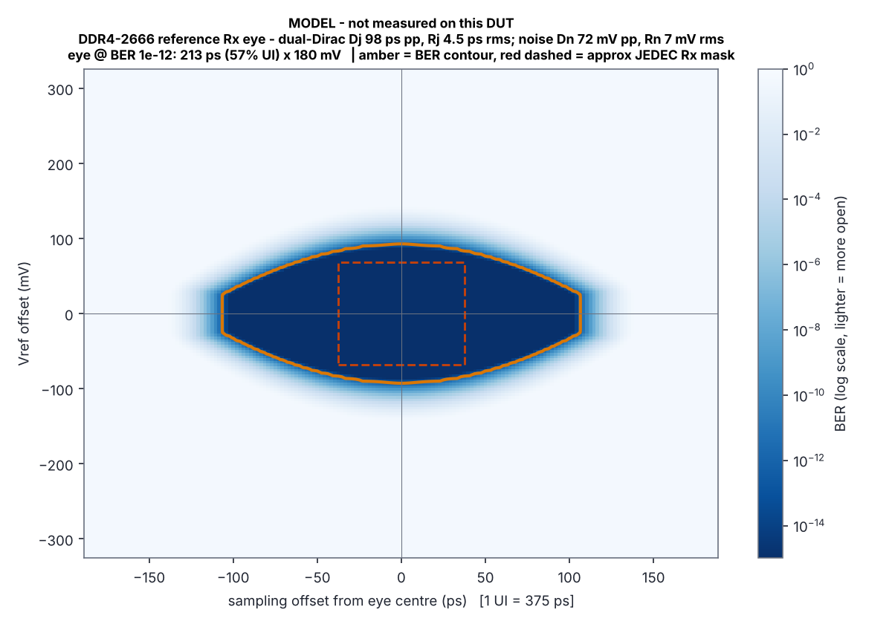
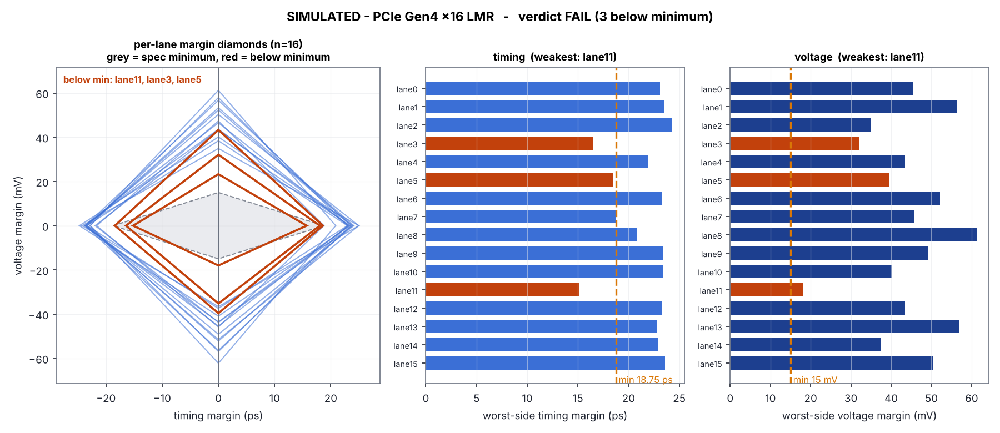
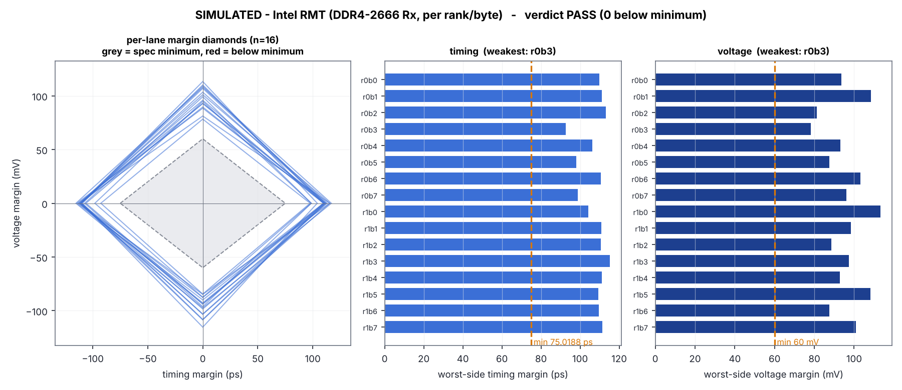
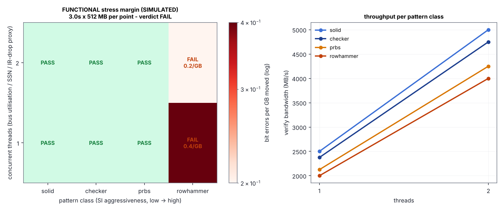

# margindump quick dump - ? ?

Run: `samples/run_simulated_demo/20261030-225507`  |  kernel Linux 6.18.44-fc-v185  |  root: True

## Verdicts (capability first, then result)

| Measurement | Capability on this box | Result | Evidence |
| --- | --- | --- | --- |
| PCIe Lane Margining (LMR) | NO PCIe LINKS VISIBLE (VM / container) | n/a | 11 functions walked; {'LEGACY_PCI': 11} |
| Intel RMT via ACPI BDAT | NO_TABLE | n/a | no BDAT ACPI table: this BIOS does not publish Intel RMT results (or ACPI tables are not readable - need root) |
| Functional stress margin | available (simulated, simulated) | FAIL | 8 points, 6 bit errors |
| SIMULATED - PCIe Gen4 x16 LMR | data present | FAIL | 16 lanes/ranks; weakest timing lane11, weakest voltage lane11; below min: ['lane3', 'lane5', 'lane11'] |
| SIMULATED - Intel RMT (DDR4-2666 Rx, per rank/byte) | data present | PASS | 16 lanes/ranks; weakest timing r0b3, weakest voltage r0b3; below min: [] |
| DDR4 reference eye | MODEL ONLY (not measured) | - | DDR4-2666: UI 375 ps, modelled eye 213 ps x 180 mV @1e-12 |

## DUT identity

- sys_vendor: None
- product_name: None
- board_vendor: None
- board_name: None
- bios_vendor: None
- bios_version: None
- bios_date: None
- cpu_model: Intel(R) Xeon(R) Processor @ 2.10GHz
- nproc: 2
- DIMMs (unavailable, ): 0 populated of 0 slots
- SPD: unavailable - no SPD EEPROM visible: needs root, i2c-i801 + ee1004 (DDR4) or spd5118 (DDR5); some boards hide SMBus SPD

## PCIe links

| BDF | device | link | LMR verdict | AER correctable |
| --- | --- | --- | --- | --- |

Functions without a PCIe capability (legacy PCI / virtio / host bridge): 11

## Functional stress margin sweep

functional stress proxy; not a voltage/timing margin. Zero errors means 'no observable failure under this stress', not 'wide eye'.

| pattern | threads | status | MB/s | GB moved | bit errors | err/GB |
| --- | --- | --- | --- | --- | --- | --- |
| solid | 1 | PASS | 2500.0 | 7.5 | 0 | 0.0 |
| solid | 2 | PASS | 5000.0 | 15.0 | 0 | 0.0 |
| checker | 1 | PASS | 2375.0 | 7.5 | 0 | 0.0 |
| checker | 2 | PASS | 4750.0 | 15.0 | 0 | 0.0 |
| prbs | 1 | PASS | 2125.0 | 7.5 | 0 | 0.0 |
| prbs | 2 | PASS | 4250.0 | 15.0 | 0 | 0.0 |
| rowhammer | 1 | FAIL | 2000.0 | 7.5 | 3 | 0.4 |
| rowhammer | 2 | FAIL | 4000.0 | 15.0 | 3 | 0.2 |

## Figures

- model_eye: `eye_model_ddr4.png`
  
- margin1d_0: `eye_margin1d_0_simulated.png`
  
- margin1d_1: `eye_margin1d_1_simulated.png`
  
- functional: `eye_functional_stress.png`
  

## Files

- `eye_functional_stress.png`
- `eye_margin1d_0_simulated.png`
- `eye_margin1d_1_simulated.png`
- `eye_model_ddr4.png`
- `eyes.json`
- `margin_sweep.json`
- `margindump.log`
- `ocptv.jsonl`
- `pcie_probe.json`
- `probe.json`

## Honest limits

- A PCIe Gen3 link cannot be margined from software: Lane Margining at Receiver exists only at 16 GT/s and above. On this class of PC the only OS-visible link health signal is the AER correctable-error counters above.
- The DDR4 PHY eye lives in the memory controller's training engine. Intel exposes it only if the BIOS runs RMT and publishes BDAT; AMD has no public equivalent. Without that, 'memory margining' from the OS is a functional stress proxy.
- The model eye is a scaled reference (correct UI for the SPD data rate), not a measurement. It exists so a measured eye can be judged against sane units.